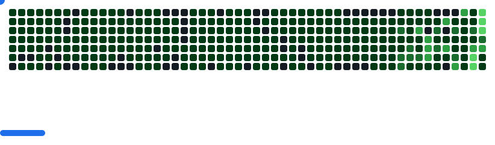

## Hi there 👋

  <picture><source media="(prefers-color-scheme: dark)" srcset="https://github-readme-stats.vercel.app/api?username=vieitesss&show_icons=true&rank_icon=percentile&include_all_commits=true&theme=gruvbox&border_radius=0&hide_border=true" /></picture>

<picture>
  
</picture>

---
#### 📑 [**My blog**](https://sb.github.io)
#### 🟦 [**LinkedIn**](https://www.linkedin.com/in/daniel-vieites/)
#### 📩 [**Mail**](mailto:dviteitest@gmail.com)
---

- ✏️ [**esbozo**](https://github.com/vieitesss/esbozo): Draw diagrams in paper.
- 🤖 [**recado**](https://github.com/vieitesss/recado): Make your agents communicate between each other.
- 📝 [**revisa.nvim**](https://github.com/vieitesss/revisa.nvim): Neovim plugin to leave comments on buffers and send them to your agents.
- ⚖️ [**minifugit.nvim**](https://github.com/vieitesss/minifugit.nvim): Neovim plugin to review git diffs.
- 🎣 [**miniharp.nvim**](https://github.com/vieitesss/miniharp.nvim): Neovim plugin, minimalist implementation based on [harpoon](https://github.com/ThePrimeagen/harpoon/tree/harpoon2).
- 📑 [**dotfiles**](https://github.com/vieitesss/dotfiles): My dotfiles (Mac and Linux).
